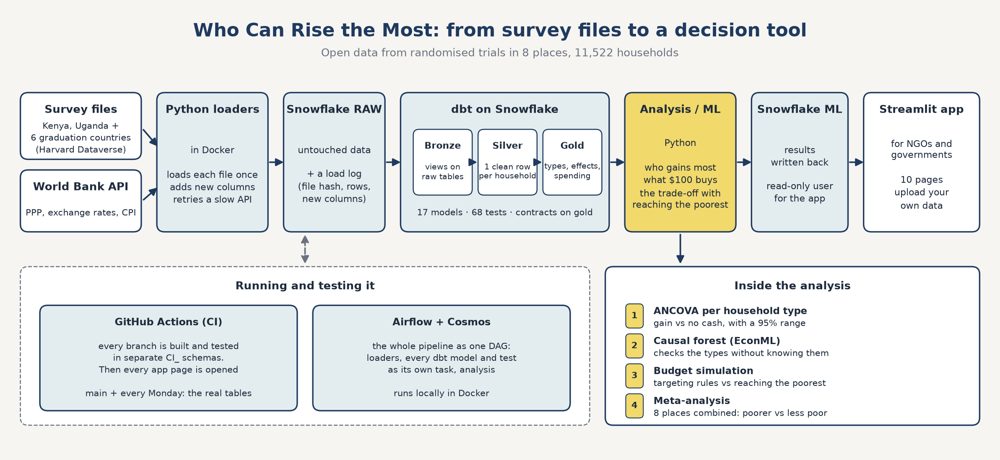

# Who Can Rise the Most

**Live app: [cash-transfer-targeting.streamlit.app](https://cash-transfer-targeting.streamlit.app)**

Which types of households should get cash to get the biggest rise in living standards for every $100, without leaving the poorest behind?

Final individual project, Data Analyst programme, Hyper Island, Stockholm (Nov 2026).

## The problem
Programmes that give cash (NGOs, UN partners and national governments building social protection systems) have a fixed budget and more poor households than they can reach. "Most good" here means the biggest rise in monthly consumption per person (PPP $) for every $100 given, while still reaching the poorest.

The data points that drive the analysis: consumption per person before and after, whether a household was offered cash (by lottery), household size and the amount transferred. This project uses open data from randomised GiveDirectly trials in Kenya (2011-12) and Uganda (2019-22) to group households into four simple types. It measures how much each type gains and what each $100 buys. A graduation programme in 6 countries (Ethiopia, Ghana, Honduras, India, Pakistan, Peru) is added as a comparison.

## What I found
- Cash raised consumption per person by about 17% in Kenya and 13% in Uganda.
- Across 8 places (2 cash trials + 6 graduation countries, 11,522 households) the poorer half gained as much as the less poor half: the combined gap is about 1 point (95% range -6.5 to +4.2). Only Uganda differed clearly, with the less poor gaining more.
- Targeting by type in Uganda gave about twice the average impact per dollar, but reached far fewer of the poorest.
- A model trained on Kenya could not find Uganda's top gainers. Programmes need their own local data.

## Architecture


```
Dataverse files (.dta, also read from inside zips)
  -> Python loader (Docker) -> Snowflake RAW
World Bank API (PPP, exchange rates, CPI) -> loader with retries -> Snowflake RAW
  -> dbt: bronze -> silver -> gold   (68 tests, contracts on gold)
  -> Python analysis (ANCOVA, causal forest with EconML, budget simulation) -> Snowflake ML
  -> Streamlit app (read-only Snowflake user)
CI/CD: GitHub Actions runs dbt build + tests on every branch (CI_ schemas) and on main every Monday
Airflow (Astro + Cosmos): the same pipeline as one DAG, every dbt model and test as its own task
```

The pipeline is built for new survey waves. Every file is loaded once (tracked by hash in `RAW._LOAD_LOG`). New columns in a later wave are added to the table instead of breaking the load.

## Repository layout
| Folder | What |
|---|---|
| `ingestion/` | Loader that lands raw survey files in Snowflake, source list, key-pair helper |
| `snowflake/` | Setup SQL: warehouse, database, roles, service users, cost limit |
| `transform/` | dbt project (bronze / silver / gold), seeds and custom tests |
| `analysis/` | Effects per household type, causal forest, budget simulation, 6 graduation countries |
| `app/` | Streamlit app |
| `airflow/` | Astro project: DAG that runs loader -> dbt (Cosmos) -> analysis |
| `prototypes/` | First Python version of the Uganda consumption total (the dbt model is checked against it) |
| `scripts/` | Check that dbt matches the prototype |

## Data
Not included in the repo. Download into `data/raw/`:
- Kenya: Haushofer & Shapiro, GiveDirectly UCT, Harvard Dataverse doi:10.7910/DVN/M2GAZN (CC0)
- Uganda: IDinsight, GiveDirectly Kiryandongo UCT, Harvard Dataverse doi:10.7910/DVN/XBVYXA (CC0)
- Graduation (6 countries incl. Pakistan): Banerjee et al. (2015), Harvard Dataverse doi:10.7910/DVN/NHIXNT (CC0)

## Run it
```bash
python -m venv .venv && .venv\Scripts\activate
pip install -r requirements.txt
python ingestion/load_raw.py --dry-run      # check files, no Snowflake needed
python ingestion/load_raw.py                # load into Snowflake RAW
python ingestion/load_worldbank.py          # World Bank prices (slow API: retries built in)
python transform/run_dbt.py build           # dbt models + tests
```
Analysis and app:
```bash
pip install -r requirements-analysis.txt
python analysis/run_analysis.py             # results -> Snowflake ML schema
pip install -r requirements-app.txt
streamlit run app/streamlit_app.py
```
Airflow (needs Docker Desktop and the Astro CLI):
```bash
python transform/run_dbt.py parse           # fresh dbt manifest for Cosmos
cd airflow && astro dev start               # UI on http://localhost:8080, DAG: cash_transfer_pipeline
```
The repo is mounted into the containers. `airflow/.env` (git-ignored) holds the Snowflake settings.

With Docker:
```bash
docker build -t ct-ingest .
docker run --rm --env-file .env -v "${PWD}/data:/app/data:ro" -v "${PWD}/.secrets:/app/.secrets:ro" ct-ingest
```
Secrets (`.env` and the `.secrets/` key folder) stay on your machine and are git-ignored.

## Limitations
- Small groups: some types have 70-80 households per arm. Every result has a 95% range.
- Kenya and Uganda use different PPP bases. Compare households within a country.
- Kenya's control group is the households in treated villages that did not get cash.
- The graduation programme is different (asset + food stipend + training). It is a comparison only.
